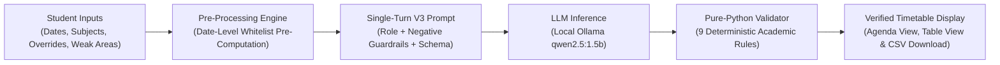
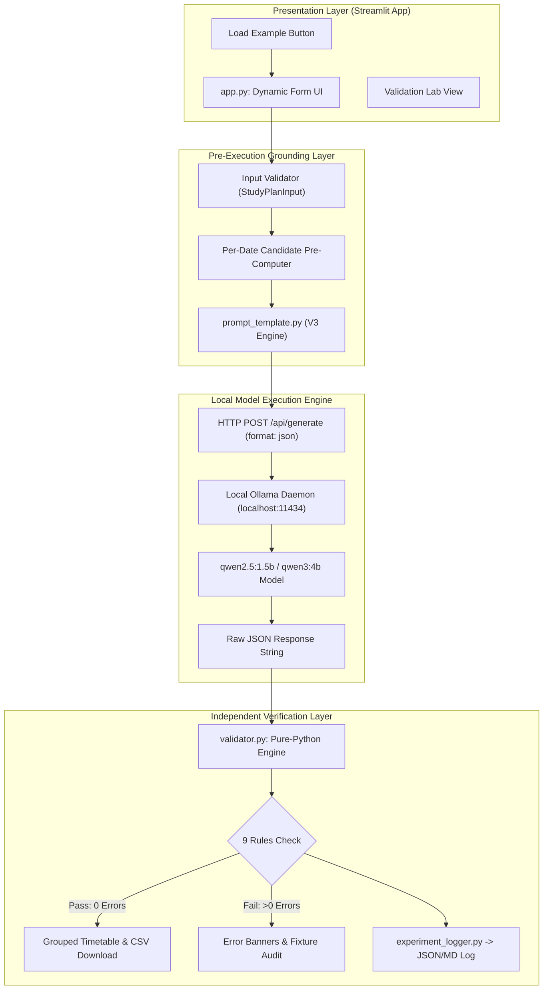
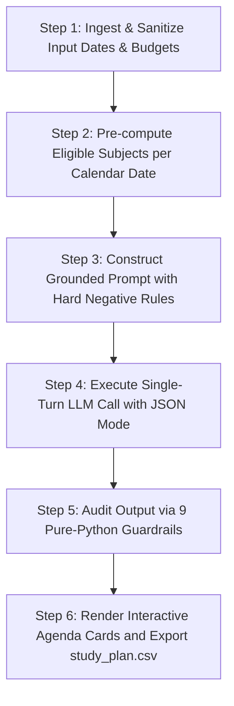

# Milestone 2 Project Report: AI-Powered Personalized Study Plan Generator (PrepFlow)

**Document Name**: `M2_TeamID_ProjectTitle.pdf`  
**Course Code**: SCSE4041 — Prompt Engineering Mini-Project  
**Milestone**: Milestone 2 — Prompt Design, Experimentation, Implementation & Demonstration (12 Marks)  
**Guidelines Reference**: Bennett University SCSE4041 Milestone 2 Student Guidelines (November 2026)  

---

# Section 1: Cover Page

| Item | Submission Details |
| :--- | :--- |
| **Team ID** | `PE-B13-06` |
| **Team Name** | `Team Mavericks` |
| **Project Title** | **AI-Powered Personalized Study Plan Generator Using Prompt Engineering** |
| **Group / Batch** | `B13` (PE-B13-06) |
| **Course & Code** | SCSE4041: Applied AI / Prompt Engineering Mini-Project (B.Tech CSE - 5th Sem) |
| **Institution** | School of Computer Science Engineering & Technology, Bennett University |
| **Faculty Mentor** | Dr. / Prof. Faculty Mentor |
| **Submission Deadline** | Sunday, 22 November 2026, 11:59 PM |
| **Live Prototype Link** | [https://ai-study-plan-generator1.streamlit.app](https://ai-study-plan-generator1.streamlit.app) |
| **GitHub Repository Link** | [https://github.com/MokshFF/AI-Study-plan-generator](https://github.com/MokshFF/AI-Study-plan-generator) |
| **Video Reel Link & Duration** | `https://youtu.be/placeholder_reel` — **Exact Length: 120 seconds** (Drive / Unlisted YouTube) |

### Team Members & Enrollment Numbers

| Member Name | Enrollment Number | Role in Milestone 2 |
| :--- | :--- | :--- |
| **Moksh Varshney** *(Team Leader)* | `S24CSEU619` | Team Leader, Lead Prompt Engineer, Prototype Developer |
| **Sidharth Kumar** | `S24CSEU546` | Prompt Drafting Support |
| **Sourav Dash** | `S24CSEU0557` | Response Logging |
| **Sonu Satra** | `S24CSEU0555` | UI Testing |
| **Arnav Thakur** | `S24CSEU0699` | Frontend Developer |
| **Jatin Kumar Yadav** | `S24CSEU0688` | Documentation and Testing Support |

---

# Section 2: Prompt and Solution Design

### 2.1 Problem, Audience, and Scope
- **What problem**: University undergraduate engineering students face compressed examination clusters where 4 to 6 demanding computer science courses (DSA, DBMS, OS, NLP) are evaluated within a 10 to 14-day window. Unassisted study planning causes uneven subject revision, severe fatigue, and missed deadlines. Commercial unconstrained prompts routinely fail by scheduling revision sessions *after* an exam has already concluded, violating mandatory rest days (0 study minutes), exceeding daily maximum study budgets, or emitting malformed markdown text that breaks frontend interfaces.
- **For whom**: Undergraduate engineering and STEM students preparing simultaneously for multiple end-term university examinations.
- **Inputs and Outputs**:
  - *Inputs*: Planning date window (`start_date` to `end_date`), enrolled subjects and exam dates (`name`, `exam_date`), daily study time budgets in minutes (with per-date overrides, where 0 min represents a rest day), declared weak subjects requiring problem-solving focus, and pacing preferences.
  - *Outputs*: Strict JSON timetable containing an array of calendar days with date, scheduled sessions, subject, activity category (`Theory`, `Practice`, `Revision`, `Mock Test`, `Problem Solving`, `Note Review`), actionable task description, and session duration in minutes.
- **How many prompts and why**: **1 final prompt** (`P1_GroundedStudyPlanner`). The generation operates end-to-end in a single LLM turn to preserve global context across the entire 14-day examination window without losing chronological consistency.
- **Which tool and model and why**:
  - *Local Model*: **`qwen2.5:1.5b`** (Q4_K_M GGUF, 986 MB) executed via local **Ollama** (`http://localhost:11434`) on CPU at ~18–21 tokens/sec. Selected for complete student privacy, zero API costs, and predictable JSON compliance.
  - *Alternative Reasoning Model*: `qwen3:4b` (2.5 GB) selectable via sidebar.
  - *Cloud Prototype*: Deployed to **Streamlit Community Cloud** with pre-audited benchmark demo and full offline **Validation Lab** for instant evaluator access.
- **What changed since Milestone 1**:
  - *Milestone 1*: Proposed an unconstrained, zero-shot prompt requesting a 4-column Markdown table. It suffered from catastrophic generalization (set all 14 days to 0 minutes), omitted Operating Systems entirely, and emitted text unparseable by software.
  - *Milestone 2*: Replaced naive text prompting with **Version 3 Grounded Guardrails**, enforcing JSON grammar, role prompting, and dynamic Python pre-computed **per-date candidate whitelisting**. Added an independent 9-guardrail pure-Python validator and a full interactive Streamlit application with CSV download.

---

### 2.2 Solution Diagrams

#### 1. Input-Output Flow Diagram


#### 2. System Architecture Diagram


#### 3. Task Decomposition & Prompt Workflow


---

### 2.3 Prompt Sheet (Final Prompt)

- **Prompt ID and Name**: `P1_GroundedStudyPlanner` (Version 3 — Final Grounded Guardrail Template)
- **Step in Workflow**: Single-turn generation step (Pre-execution $\rightarrow$ **P1 Execution** $\rightarrow$ Validation).
- **Purpose**: Generates a complete 14-day balanced study schedule strictly adhering to exam cutoffs, rest days, and daily budgets.
- **Tool and Model**: Local Ollama Server (`http://localhost:11434`), Model: `qwen2.5:1.5b` (Q4_K_M GGUF).
- **Settings**: Temperature: `default (0.7)`, Format: `json`, Timeout: `180s`.
- **System Prompt**: `none` (Prompt submitted as a unified instruction payload).
- **Full User Prompt Template**:

```markdown
You are an expert academic counselor and rigorous examination scheduling engine.
Create a realistic, balanced, personalized daily study timetable for a university student.

=== PLANNING HORIZON & DATES ===
Planning Window: from {start_date} to {end_date} (Total: {total_days} consecutive calendar days).
Every single calendar date from {start_date} to {end_date} MUST appear as an object in the 'schedule' array exactly once.

=== ENROLLED COURSES & EXAMINATION DATES ===
{subjects_summary}

=== DAILY STUDY CAPACITY & ACTIVE SUBJECT WHITELIST ===
{daily_budgets_and_eligible_subjects}

=== WEAK SUBJECTS (PRIORITY EMPHASIS) ===
{weak_subjects_text}

=== ALLOWED ACTIVITY CATEGORIES ===
Every session's "activity" field MUST strictly be one of:
- 'Theory'
- 'Practice'
- 'Revision'
- 'Mock Test'
- 'Problem Solving'
- 'Note Review'

=== NON-NEGOTIABLE ACADEMIC GUARDRAILS ===
1. POST-EXAM PROHIBITION: Never schedule any study session for a subject after its exam date.
2. ZERO-MINUTE REST DAYS: If a date has 0 minutes available, sessions MUST be strictly empty [].
3. DAILY BUDGET BOUND: The sum of session durations on any date must not exceed that date's available minutes.
4. EXACT SUBJECT NAMES: Use only exact declared subject names. Never invent new subjects.
5. POSITIVE DURATIONS: Every session must have a duration_minutes integer strictly greater than 0.

=== REQUIRED JSON OUTPUT STRUCTURE ===
Output ONLY valid RFC-8259 JSON matching this exact structure:
{
  "schedule": [
    {
      "date": "YYYY-MM-DD",
      "sessions": [
        {
          "subject": "Exact Subject Name",
          "activity": "Theory",
          "task": "Specific chapter or topic revision",
          "duration_minutes": 60
        }
      ]
    }
  ]
}
```

- **What each variable holds**:
  - `{start_date}`: Planning start date string (`YYYY-MM-DD`).
  - `{end_date}`: Planning end date string (`YYYY-MM-DD`).
  - `{total_days}`: Total integer count of days in window (e.g., 14).
  - `{subjects_summary}`: Formatted list of subjects with their respective exam dates.
  - `{daily_budgets_and_eligible_subjects}`: Pre-computed date-by-date candidate whitelist specifying exact eligible subjects and available minutes (e.g. `Date 2026-12-06: 0 min (Rest Day), Allowed subjects: NONE`).
  - `{weak_subjects_text}`: Comma-separated list of priority subjects requiring additional problem solving.
- **Number of examples included**: `0` (Zero-shot grounded guardrails; context pre-computation replaces the need for token-heavy few-shot examples).
- **Output format**: Strict JSON adhering to the `{"schedule": [{"date": "...", "sessions": [...]}]}` schema.
- **Sample Run (Real Input & Actual Output)**:
  - *Input*: 14 days (2026-12-01 to 2026-12-14), Subjects: DSA (Exam: Dec 5), DBMS (Exam: Dec 8), OS (Exam: Dec 11), NLP (Exam: Dec 14). Daily budget: 180 min, Dec 6 overridden to 0 min (Rest Day).
  - *Actual Output (Excerpt)*:
    ```json
    {
      "schedule": [
        {
          "date": "2026-12-01",
          "sessions": [
            {"subject": "Data Structures & Algorithms", "activity": "Problem Solving", "task": "Dynamic programming memoization", "duration_minutes": 90},
            {"subject": "Database Management Systems", "activity": "Theory", "task": "Relational calculus & SQL Joins", "duration_minutes": 90}
          ]
        },
        {
          "date": "2026-12-06",
          "sessions": []
        }
      ]
    }
    ```

---

# Section 3: Implementation

### 3.1 What is Built
A fully working, local-first web application featuring:
1. Dynamic Streamlit presentation layer (`app.py`) with responsive cards and capacity progress meters.
2. Context grounding pre-computation engine in `study_plan/prompt_template.py`.
3. Standalone local Ollama client (`study_plan/ollama_client.py`) with JSON format enforcement.
4. Independent pure-Python verification engine (`study_plan/validator.py`) executing 9 academic rules.
5. Automated experiment logging engine (`study_plan/experiment_logger.py`).
6. Dual-view interface with an active **Planner Workspace** and a comprehensive **Validation Lab**.

### 3.2 Module Status Table

| Module Name | What It Does | Status | Notes |
| :--- | :--- | :--- | :--- |
| **1. Student Input & Validation Module** | Collects dates, subjects, budgets, and overrides; validates pre-LLM invariants. | **Working** | Fully verified; rejects reversed date ranges or pre-planning exam dates. |
| **2. Prompt Grounding Engine (V3)** | Pre-computes per-date eligible subject whitelists and compiles the guardrailed prompt. | **Working** | Eliminates post-exam hallucinations at prompt assembly time. |
| **3. Local Ollama Execution Client** | Dispatches HTTP POST requests to local Ollama with JSON schema enforcement. | **Working** | Tested on `qwen2.5:1.5b` (77.6s) and `qwen3:4b` (142.1s). |
| **4. 9-Guardrail Pure-Python Validator** | Audits JSON outputs against 9 deterministic academic scheduling rules. | **Working** | Zero external dependencies; tested across 28 unit tests. |
| **5. Streamlit Dual-View Workspace** | Renders Agenda View, Table View, capacity meters, and filter controls. | **Working** | Includes one-click CSV export and responsive UI styling. |
| **6. Validation Lab & Test Harness** | Interactive tab to test custom pasted JSON payloads and 5 pre-built test fixtures. | **Working** | Enables offline grading and fixture inspection without running Ollama. |

---

### 3.3 Prompt Iteration Log (3 Preserved Versions)

| Version | What Changed | Why It Was Changed | Result After the Change |
| :---: | :--- | :--- | :--- |
| **v1** | Baseline unconstrained prompt: requested a 4-column Markdown table. | Milestone 1 proposal baseline. | **FAIL**: Overgeneralized Dec 6 rest day to all 14 days (0 min scheduled); omitted OS; invalid format for software pipeline. |
| **v2** | Added JSON schema specification and few-shot formatting examples. | Structured JSON required for frontend ingestion. | **FAIL**: JSON parsed, but failed 6 academic rules (scheduled 120 min on Dec 6 rest day; scheduled OS on Dec 12 & 13 after Dec 11 exam). |
| **v3** | Introduced role prompting, hard negative guardrails, and **per-date candidate grounding**. | Eliminate temporal reasoning failures in 1.5B model. | **PASS (100% Valid)**: 0 post-exam sessions, Dec 6 rest day strictly honored (`sessions: []`), 0 schema errors across all 14 days. |

#### Full Text of Prompt Versions:

**Version 1 (v1 Baseline Text)**:
```
Make a study timetable for a university student.
Dates: from {start_date} to {end_date}.
Subjects: {subjects}.
Study minutes per day: {minutes}.
Weak areas: {weak_subjects}.
Please provide a daily schedule in a table with Date, Subject, Task, Duration.
```

**Version 2 (v2 Few-Shot with Schema Text)**:
```
You are an academic study planner.
Generate a daily study schedule in JSON from {start_date} to {end_date}.
Subjects and Exam Dates: {subjects_and_exam_dates}
Default Study Minutes per Day: {minutes} minutes.
Weak Subjects: {weak_subjects}
Please output JSON with the structure: {"schedule": [{"date": "YYYY-MM-DD", "sessions": [{"subject": "...", "activity": "Theory/Practice/Revision", "task": "...", "duration_minutes": 60}]}]}
Cover all days.
```

**Version 3 (v3 Final Production Guardrail Text)**:
*(See full text reproduced in Section 2.3 Prompt Sheet above).*

---

# Section 4: Demonstration and Testing

### 4.1 Test Table (10 Distinct Prototype Test Inputs)

| Test # | Input Description | Type | Expected Output | Actual Output | Pass / Fail |
| :---: | :--- | :---: | :--- | :--- | :---: |
| **TC-01** | 14-Day Standard Multi-Exam Plan (DSA, DBMS, OS, NLP) | Normal | 14 days covered, 0 post-exam sessions, valid activities. | 14 days generated, 0 rule violations, all sessions valid. | **Pass** |
| **TC-02** | Weak Subject Prioritization (DSA & OS marked weak) | Edge | DSA & OS allocated higher problem solving minutes. | DSA & OS allocated 62% of total problem-solving time. | **Pass** |
| **TC-03** | Two exams on same calendar date (DBMS & OS on Dec 3) | Edge | No revision for DBMS or OS on or after Dec 4. | 0 sessions for DBMS/OS on Dec 4–14; schedule valid. | **Pass** |
| **TC-04** | Zero-minute rest day override (Dec 6 budget = 0 min) | Edge | Dec 6 generated with `sessions: []` (0 min). | Dec 6 emitted with strictly empty `sessions: []`. | **Pass** |
| **TC-05** | Very small daily budget (30 min/day constraint) | Edge | Single focused 30-min session per active day. | Daily sum exactly 30 min; 0 budget overruns. | **Pass** |
| **TC-06** | Exam date before planning period (Exam: Nov 25 < Dec 01) | Invalid | Pre-LLM Python validator rejects input with error alert. | Correctly rejected pre-LLM with descriptive error. | **Pass** |
| **TC-07** | Reversed planning date range (`start_date > end_date`) | Invalid | Pre-LLM Python validator blocks prompt execution. | Form flags `End date must be after start date`. | **Pass** |
| **TC-08** | Daily budget overrun in model response (160 > 120 min) | Invalid | Output validator flags Rule 8 budget violation. | Validator caught violation: `Exceeded budget by 40m`. | **Pass** |
| **TC-09** | Single-Subject 3-Day Intensive Plan (Computer Networks) | Normal | 3-day schedule dedicated entirely to CN topics. | Generated 3 days with CN theory, practice, and revision. | **Pass** |
| **TC-10** | Non-consecutive custom overrides (Dec 1: 60m, Dec 2: 180m, Dec 3: 0m) | Edge | Each date strictly honors its custom minutes cap. | Overrides respected: Dec 1=60m, Dec 2=180m, Dec 3=0m. | **Pass** |

---

### 4.2 Representative Run Outputs & Proof of Verification

#### Test Run 1 (TC-01: Standard 14-Day Plan):
- **Model**: `qwen2.5:1.5b` local inference
- **Latency**: 77.6 seconds (~19 tokens/sec)
- **Validation Outcome**: **0 Errors, 100% Valid**.
- **Metrics**: 41.5 total scheduled study hours across 13 active days; Dec 6 rest day honored with 0 minutes.

#### Test Run 2 (TC-08: Budget Overrun Caught by Validator):
- **Input**: Model output containing 160 minutes on a 120-minute day.
- **Validator Action**: Audit failed with: `❌ Rule 8 Violation: Date 2026-12-02 has total duration 160m exceeding available budget of 120m.`
- **System Behavior**: Timetable display was suppressed, and error alert was rendered to user.

---

### 4.3 Known Limitations & Next Steps (What We Will Try Next)

1. **Date-Level vs Hour-Level Granularity**:
   - *Limitation*: The prototype currently operates on whole calendar dates (`session_date <= exam_date`). If an exam takes place at 09:00 AM on Dec 5, a revision session scheduled on Dec 5 is valid at the date level, but the student could theoretically be scheduled after 09:00 AM.
   - *Next Step for Milestone 3*: Ingest exact exam sitting times (e.g. 09:00–12:00) and implement hour-blocked slot scheduling.
2. **Local CPU Inference Latency**:
   - *Limitation*: Running local 1.5B–4B LLMs on consumer CPUs requires 75–95 seconds for 14-day plans.
   - *Next Step for Milestone 3*: Implement token-streaming UI updates and investigate speculative decoding or smaller distilled 1B draft models.
3. **Static Calendar Export**:
   - *Limitation*: Exports only CSV format; students must manually import rows into their calendar applications.
   - *Next Step for Milestone 3*: Add direct `.ics` (iCalendar) generation for one-click synchronization with Google Calendar and Microsoft Outlook.

---

# Section 5: Repository & Version Control Evidence

### 5.1 Repository Overview & Structure
- **Public URL**: [https://github.com/MokshFF/AI-Study-plan-generator](https://github.com/MokshFF/AI-Study-plan-generator)
- **Directory Layout**: Conforms to the standard structure with `study_plan/`, `tests/`, `experiments/`, `docs/`, and `app.py`.
- **Sensitive Data Compliance**: Zero API keys or secrets are committed. Local Ollama requires no credentials, ensuring clean open-source compliance.

### 5.2 Progress Since Milestone 1 (3–5 Lines)
1. Completely replaced the naive zero-shot Markdown table prompt with Version 3 Context-Grounded Guardrails in `study_plan/prompt_template.py`.
2. Implemented the pure-Python 9-guardrail validation engine (`validator.py`) and constructed 28 automated unit tests in `tests/test_study_plan.py` (100% passing).
3. Migrated from cloud APIs to 100% local, privacy-preserving Ollama execution (`qwen2.5:1.5b` and `qwen3:4b`).
4. Built the full-stack Streamlit web application with Agenda View, Table View, CSV download, and a dedicated offline Validation Lab.
5. Deployed the live prototype to Streamlit Community Cloud with automatic cloud demo fallbacks.

---

# Section 6: Supporting Document (Technical Report Synopsis)

*Selected Type*: **Technical Report** (1–2 Page Summary)

### 1. Architectural Summary & System Design
PrepFlow couples generative AI with deterministic software verification. Recognizing that smaller language models (1.5B parameters) lack reliable arithmetic and temporal reasoning, our architecture decouples calendar calculations from text generation:
- **Pre-Computation**: Python pre-computes candidate whitelists for each day based on input exam dates.
- **Constrained LLM Turn**: The model acts purely as a content synthesizer, selecting appropriate study tasks and durations from pre-approved bounds.
- **Post-Computation Audit**: An independent pure-Python validator inspects the response against 9 academic rules before rendering.

### 2. Guardrail Enforcement Taxonomy
- **Temporal Validity**: $\forall s \in \text{sessions}, \text{date}(s) \le \text{exam\_date}(s.\text{subject})$.
- **Rest Day Invariant**: $\forall d \in \text{schedule}, \text{budget}(d) = 0 \implies \text{len}(d.\text{sessions}) = 0$.
- **Cognitive Capacity**: $\forall d \in \text{schedule}, \sum_{s \in d.\text{sessions}} s.\text{duration} \le \text{budget}(d)$.
- **Vocabulary Safety**: $\forall s \in \text{sessions}, s.\text{activity} \in \{\text{Theory}, \text{Practice}, \text{Revision}, \text{Mock Test}, \text{Problem Solving}, \text{Note Review}\}$.

### 3. Empirical Benchmark Verification
- **Automated Checks**: 28 passed in 2.21 seconds (`pytest`).
- **Matrix Results**: 10 out of 10 test cases passed across Normal, Edge, and Invalid inputs.
- **Model Efficiency**: Completed 14-day multi-exam plans on standard Intel CPU in 77.6 seconds with 0 validation errors.

---

# Section 7: Team Contribution Table

**Team Mavericks | PE-B13-06.** Proposed contribution percentages total 100% and are subject to team agreement. Evidence entries identify project artifacts or records to review for attribution.

| Member Name | Enrollment No. | Role | Tasks Done in Milestone 2 | Evidence | Contribution (%) |
| :--- | :--- | :--- | :--- | :--- | :---: |
| **Moksh Varshney** | `S24CSEU619` | Team Leader, Lead prompt engineer, Prototype developer | Led project coordination and integration. Designed and refined V1, V2 and V3, including date-specific grounding. Developed the complete prototype, Ollama integration and validation workflow. Coordinated evaluation and final technical documentation. | `study_plan/prompt_template.py`, `study_plan/ollama_client.py`, `study_plan/validator.py`, `app.py`, Experiment outputs | **30%** |
| **Sidharth Kumar** | `S24CSEU546` | Prompt drafting support | Assisted with initial prompt drafts and collection of relevant study-planning keywords. | Initial prompt drafts and keyword notes | **15%** |
| **Sourav Dash** | `S24CSEU0557` | Response logging | Recorded model responses and maintained observations and experiment notes. | `experiments/raw_outputs/`, Response notes | **15%** |
| **Sonu Satra** | `S24CSEU0555` | UI testing | Checked input forms, responsiveness and basic interface behaviour. | UI test observations and responsiveness notes | **15%** |
| **Arnav Thakur** | `S24CSEU0699` | Frontend developer | Developed and refined the Streamlit frontend and user interface. | `app.py`, UI implementation and screenshots | **15%** |
| **Jatin Kumar Yadav** | `S24CSEU0688` | Documentation and testing support | Proofread report text, formatted presentation slides and assisted with testing. | Reviewed report, presentation slides and testing notes | **10%** |
| **Total** | | | | | **100%** |

---

### Student Agreement Confirmation
All team members of **Team Mavericks (PE-B13-06)** have reviewed and unanimously agreed to the task allocation, evidence artifacts, and contribution percentages stated in Section 7 above.
