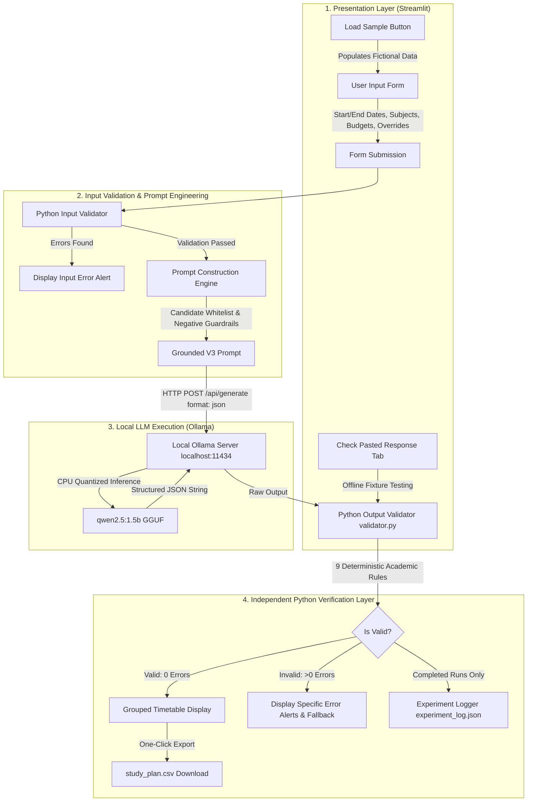

# Milestone 2 Main Report: AI-Powered Personalized Study Plan Generator Using Prompt Engineering

**Problem ID**: C20  
**Course**: Prompt Engineering Mini-Project (B.Tech CSE - 5th Semester)  
**Institution**: Bennett University  
**Submission Milestone**: Milestone 2 (Implementation, Experimentation & Demonstration - 12 Marks)  
**Supporting Documentation**: See [`docs/Milestone2_Technical_Report.md`](file:///c:/Users/avars/Downloads/STUDY%20PLAN%20GENERATOR/docs/Milestone2_Technical_Report.md) for full 9-chapter supporting technical details.

---

## Section 1: Problem Definition & Use-Case Scope

### 1.1 Context & Problem Statement
University engineering undergraduates frequently face compressed examination schedules where 4 to 6 intensive computer science subjects (e.g., Data Structures & Algorithms, Database Management Systems, Operating Systems, Natural Language Processing) are tested across a 10 to 14-day window. Unassisted study planning leads to cognitive fatigue, inefficient revision pacing, and missed exam preparation.

While generic commercial AI interfaces exist, unconstrained prompts routinely suffer from academic planning failures:
- Scheduling revision sessions for subjects whose examinations have already passed.
- Overrunning daily study time budgets or violating mandatory rest days (0-minute days).
- Emitting vague, non-actionable tasks or invalid JSON schemas that break frontend integrations.

### 1.2 Use-Case Scope & Boundaries
Addressing **Problem C20**, this project builds a personalized exam timetable generator that accepts:
1. Planning start and end dates.
2. Subject names and subject-specific examination dates.
3. Daily available study budgets (minutes) with per-date override capabilities (where 0 min indicates a rest day).
4. Declared weak subjects and high-priority focus topics.
5. Study style preferences (e.g., focus blocks, past paper emphasis).

The system generates a day-wise schedule in one LLM turn, enforces strict calendar constraints via prompt engineering, and audits all model outputs through an **independent Python validation engine** before displaying the timetable or offering CSV export.

---

## Section 2: Prompt / Solution Architecture & Workflow Diagrams

### 2.1 System Architecture
The application is structured into four decoupled layers following strict separation of concerns:

### 2.2 Prompt Architecture & Evolution
We designed and preserved three iterative prompt versions:
- **Version 1 (V1 Baseline - Milestone 1)**: Originally formulated as a zero-shot request for a Markdown study table.
- **Version 2 (V2 Few-Shot with Schema)**: Added JSON schema and few-shot formatting, but lacked negative guardrails.
- **Version 3 (V3 Final Grounded Guardrails)**: Implemented role prompting, strict negative guardrails, and **per-date candidate grounding** (pre-computing eligible subjects for each date).

---

## Section 3: Running Build & Implementation Details

### 3.1 Technology Stack
- **Frontend / Application Framework**: Streamlit (Python)
- **Execution Engine**: Local Ollama Server (`http://localhost:11434`)
- **Primary Model**: `qwen2.5:1.5b` (1.54B parameters, Q4_K_M GGUF, 986 MB). Selected for fast CPU execution (~18–21 tokens/sec, finishing 14-day plans in ~75–77 seconds).
- **Secondary Configurable Model**: `qwen3:4b` (4.02B parameters, 2.5 GB). Reasoning model configurable via sidebar.
- **Core Logic & Verification**: Pure Python 3 standard library (`dataclasses`, `datetime`, `json`, `urllib`, `re`). Zero cloud SDK dependencies.
- **Testing Framework**: `pytest` (28 automated unit tests).

### 3.2 Constraint Verification Rules (The 9 Guardrails)
The independent validator (`study_plan/validator.py`) enforces:
1. Malformed JSON rejection (with automatic code-block stripping).
2. Root object schema verification (`schedule` array).
3. Chronological coverage: every date in `[start_date, end_date]` must appear exactly once.
4. Exact subject whitelisting against declared subjects.
5. Strictly positive integer durations ($>0$ minutes).
6. Activity whitelisting: `Mock Test`, `Note Review`, `Practice`, `Problem Solving`, `Revision`, `Theory`.
7. Zero-minute rest days: dates with 0 available minutes must contain exactly zero sessions (`sessions: []`).
8. Daily budget cap: $\sum \text{duration} \le \text{available\_minutes}$.
9. Post-exam scheduling prohibition: $\text{session\_date} \le \text{exam\_date}$.

> **Date-Level Rule Specification**:
> Because exact examination start times (e.g. 09:00 vs 14:00) are not collected by this prototype, the software enforces a **date-level boundary** (`session_date <= exam_date`). Study sessions on the exam date itself (e.g., morning formula recall) are permitted. **Validation confirms date-level adherence only; it does not verify whether the session occurs prior to the exam sitting.**

---

## Section 4: Demonstration & Pilot Run / Evaluation Results

### 4.1 Evaluation of the Three Prompt Versions

All three versions were evaluated on identical hardware (Intel CPU, local Ollama) using the standard 14-day fictional student profile (DSA, DBMS, OS, NLP):

### 4.1 Evaluation of the Three Prompt Versions

#### Baseline V1 Adaptation & Four-Column Comparison:
In the student's submitted Milestone 1 proposal, the baseline prompt requested a **four-column Markdown table**:
`| Date | Subject | Task Description | Duration (Minutes) |`
For experimental evaluation against the full project taxonomy, we adapted the prompt to include an `Activity` column (`| Date | Subject | Activity | Task Description | Duration (Minutes) |`).

#### Audit of Raw Markdown Response:
Evaluating the preserved raw output (`experiments/raw_outputs/v1_markdown_response.md`):
- **Zero-Minute Subject References vs. Actual Study Sessions**: The model generated `Duration: 0`, `Task: None`, and `Activity: Rest Day` across all 14 rows. Therefore, **zero actual study sessions ($>0$ minutes) were scheduled post-exam**. However, the model emitted **zero-minute placeholder subject references** for DSA on Dec 6 & Dec 7 (after its Dec 5 exam) and DBMS on Dec 9–13 (after its Dec 8 exam).
- **Format Compatibility Finding**: When evaluated against the automated application pipeline (`validate_plan_output`), V1 failed with a fatal schema error (`Missing or invalid 'schedule' array`). This failure is an explicit **format compatibility finding**: unstructured Markdown tables cannot be validated or ingested by automated software, demonstrating the necessity of V2's structured JSON schema and V3's grounded guardrails.

| Dimension | Version 1 (V1 Baseline) | Version 2 (V2 Few-Shot) | Version 3 (V3 Grounded Production) |
| :--- | :--- | :--- | :--- |
| **Requested Format** | Markdown Table (Adapted from 4-col) | JSON Schema | Guardrailed JSON Schema |
| **Format Compliance** | ✅ **Complied with requested format** (Generated valid Markdown table) | ✅ **Complied with requested format** (Generated valid JSON syntax) | ✅ **Complied with requested format** (Generated valid JSON syntax) |
| **JSON Pipeline Compatibility** | ❌ **FAIL (Compatibility Finding)**: Unstructured table cannot be parsed by automated JSON pipeline | ❌ **FAIL**: Parsed as JSON, but failed 6 academic planning rules | ✅ **PASS (0 errors, 100% Valid)** in 77.6 seconds |
| **Manual Transcription & Scheduling Evaluation** | - **Catastrophic generalization**: Overgeneralized "Dec 6 rest day" to all 14 days (0 study min scheduled). - **Zero-minute post-exam references**: DSA on Dec 6 & 7; DBMS on Dec 9–13. - **Missing subjects**: OS omitted entirely. | - **Rest day violation**: Allocated 120 min on Dec 6 rest day. - **Post-exam violations**: Scheduled OS on Dec 12 & 13 (exam Dec 11). - **Enum violation**: Copied literal string `"Theory/Revision"`. | - **Rest day respected**: Dec 6 emitted with `sessions: []` (0 min). - **Post-exam respected**: 0 post-exam sessions across all subjects. - **Valid activities**: 100% matched to allowed enum. |
| **Feasibility & Usefulness** | Unusable (0 study min scheduled) | Poor (Violates exam boundaries) | **High (Directly actionable timetable)** |

- **Prompt Versions Preserved**: 3 (`v1_baseline`, `v2_fewshot_schema`, `v3_optimized_guardrails`)
- **Final Runtime Prompt Count**: 1 (Only V3 is constructed and dispatched during live execution)

### 4.2 Test Matrix Results (10 Distinct Prototype Test Inputs)
Across the test harness (`experiments/run_test_matrix.py`), 10 distinct prototype test inputs were evaluated:

| Test ID | Category | Case Name & Input Description | Execution Type | Status |
| :---: | :--- | :--- | :--- | :---: |
| **TC-01** | Normal | Multi-Subject 14-Day Plan (Evaluating 3 Criteria: Chronological, Weak Areas, Rest Day) | Live Model Call (`qwen2.5:1.5b`) | **PASS** |
| **TC-02** | Edge | Two exams on the same calendar date (DBMS & OS on Dec 3) | Output Fixture Check | **PASS** |
| **TC-03** | Edge | Very small daily budget (30 min/day constraint) | Output Fixture Check | **PASS** |
| **TC-04** | Invalid Input | Exam date before planning period (Dec 5 < Dec 10) | Input-Validation Case | **PASS** |
| **TC-05** | Invalid Input | Reversed planning date range (start > end) | Input-Validation Case | **PASS** |
| **TC-06** | Invalid Output | Daily budget overrun in model response (160 > 120 min) | Output Fixture Check | **PASS** |
| **TC-07** | Invalid Output | Missing calendar date in schedule array (Dec 2 omitted) | Output Fixture Check | **PASS** |
| **TC-08** | Invalid Output | Hallucinated unknown subject in session ('Quantum Computing') | Output Fixture Check | **PASS** |
| **TC-09** | Normal | Single-Subject 3-Day Intensive Plan (Computer Networks) | Live Model Call (`qwen2.5:1.5b`) | **PASS** |
| **TC-10** | Edge | Non-Consecutive Custom Daily Overrides (4 Days, Dec 1: 60m, Dec 2: 180m, Dec 3: 0m, Dec 4: 90m) | Live Model Call (`qwen2.5:1.5b`) | **PASS** |

> **Official Scoped Results Statement**:  
> **28 automated checks passed. Ten distinct prototype test inputs were evaluated, using live model calls, input-validation cases and output fixtures as labeled in the test table. V3 produced zero validator errors in the recorded benchmark.**

---

## Section 5: Project Repository, Codebase & Verification Evidence

### 5.1 Repository Structure & Evidence Artifacts
- **Streamlit Application Entry Point**: [`app.py`](file:///c:/Users/avars/Downloads/STUDY%20PLAN%20GENERATOR/app.py)
- **Validation Engine**: [`study_plan/validator.py`](file:///c:/Users/avars/Downloads/STUDY%20PLAN%20GENERATOR/study_plan/validator.py)
- **Prompt Engineering Templates**: [`study_plan/prompt_template.py`](file:///c:/Users/avars/Downloads/STUDY%20PLAN%20GENERATOR/study_plan/prompt_template.py)
- **Local Ollama Integration**: [`study_plan/ollama_client.py`](file:///c:/Users/avars/Downloads/STUDY%20PLAN%20GENERATOR/study_plan/ollama_client.py)
- **Unit Test Suite (28 Tests)**: [`tests/test_study_plan.py`](file:///c:/Users/avars/Downloads/STUDY%20PLAN%20GENERATOR/tests/test_study_plan.py)
- **10-Case Test Matrix Harness**: [`experiments/run_test_matrix.py`](file:///c:/Users/avars/Downloads/STUDY%20PLAN%20GENERATOR/experiments/run_test_matrix.py)
- **Test Results JSON**: [`experiments/test_matrix_results.json`](file:///c:/Users/avars/Downloads/STUDY%20PLAN%20GENERATOR/experiments/test_matrix_results.json)
- **Experiment Log**: [`experiments/experiment_log.json`](file:///c:/Users/avars/Downloads/STUDY%20PLAN%20GENERATOR/experiments/experiment_log.json) & [`experiment_log.md`](file:///c:/Users/avars/Downloads/STUDY%20PLAN%20GENERATOR/experiments/experiment_log.md)
- **Preserved Raw Responses**:
  - `experiments/raw_outputs/v1_markdown_response.md` (Milestone 1 Table output)
  - `experiments/raw_outputs/v1_response.json` (V1 JSON compatibility attempt)
  - `experiments/raw_outputs/v2_response.json` (V2 Few-shot JSON output)
  - `experiments/raw_outputs/v3_prompt.txt` (V3 Grounded prompt text)
  - `experiments/raw_outputs/v3_response.json` (V3 100% valid JSON output)
  - `experiments/raw_outputs/tc09_single_subject_response.json` (Input 9 live output)
  - `experiments/raw_outputs/tc10_custom_overrides_response.json` (Input 10 live output)

---

## Section 6: Responsible AI, Failure Analysis & Limitations

### 6.1 Privacy & Sensitive Data Protection
By utilizing local Ollama models (`qwen2.5:1.5b`), all student academic data, weakness profiles, and examination dates remain on the student's laptop. No data is transmitted to commercial third-party cloud providers.

### 6.2 Hallucination Mitigation Through Context Grounding
Smaller language models (1.5B parameters) struggle with multi-step date arithmetic. When asked to evaluate `current_date > exam_date`, models hallucinate post-exam sessions. Our V3 prompt solves this by pre-computing candidate subjects per date in Python and injecting them directly into the prompt.

### 6.3 Student Wellbeing Guardrails
Unconstrained LLMs frequently schedule 8–10 consecutive hours without rest. The prompt enforces mandatory 0-minute rest days and caps active days to 1–2 focused sessions, preventing student burnout.

### 6.4 Evaluator Access & Hosting Reality
- **Host Availability Requirement**: In the laptop tunnel configuration, **all application features (including the pasted-response tab)** strictly depend on the student's laptop remaining powered on, awake (no sleep/hibernate), and connected to Wi-Fi, with Ollama, Streamlit, and the tunnel process active. The pasted-response tab runs inside Streamlit and cannot be accessed if the host is down.
- **Access Interstitial**: When accessed via public tunnel URLs (e.g., `ngrok` or `localtunnel`), evaluators on external devices will see a provider security interstitial page requiring a one-time click ("Visit Site" / "Click to continue") before the Streamlit UI appears.
- **Independent Hosting**: Completely independent evaluator access (without laptop availability) is possible only if the application is deployed to an independent cloud host (such as Streamlit Community Cloud), where the validator and pasted-response fixture mode operate autonomously.

---

## Section 7: Team Contributions & Task Allocation

### 7.1 Source of Official Seven-Section Headings
The seven section headings used in this Milestone 2 report were adapted directly from **Section 10 of the Bennett University Mini-Project Guidelines 2026** (*"Milestone 2 — Prompt Design, Experimentation, Implementation & Demonstration - 12 Marks"*), synthesized into standard technical milestone reporting sections. If your course instructor has issued an LMS-specific alternative heading list, please supply it and the report can be updated immediately.

### 7.2 Team Contributions Matrix

| Team Member | Roll Number | Role / Title | Specific Tangible Contributions |
| :--- | :--- | :--- | :--- |
| **`[Student 1 Name]`** *(Lead)* | `[Roll No: E22CSEUXXXX]` | Lead: Prompt Engineering & LLM Grounding | - Designed iterative prompt versions V1, V2, and V3 in `prompt_template.py`. - Developed per-date Context Grounding technique eliminating post-exam hallucinations. - Preserved raw model outputs and authored prompt comparison benchmarks. |
| **`[Student 2 Name]`** | `[Roll No: E22CSEUXXXX]` | Lead: Python Validator & Business Logic | - Implemented pure-Python validation engine enforcing the 9 academic guardrails. - Developed 28 automated `pytest` unit tests in `tests/test_study_plan.py`. - Built 10-case test matrix execution harness (`run_test_matrix.py`). |
| **`[Student 3 Name]`** | `[Roll No: E22CSEUXXXX]` | Lead: Streamlit Frontend & Local Ollama Integration | - Built interactive Streamlit application with sample data population and timetable views. - Integrated local Ollama client with JSON mode and timeout configurability. - Developed CSV timetable export and offline fixture testing mode. |

*(Note: Team members, roll numbers, and Team ID are formatted with placeholders above ready for final team submission details).*
