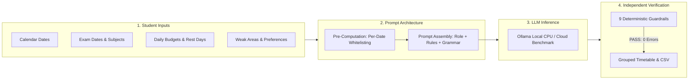
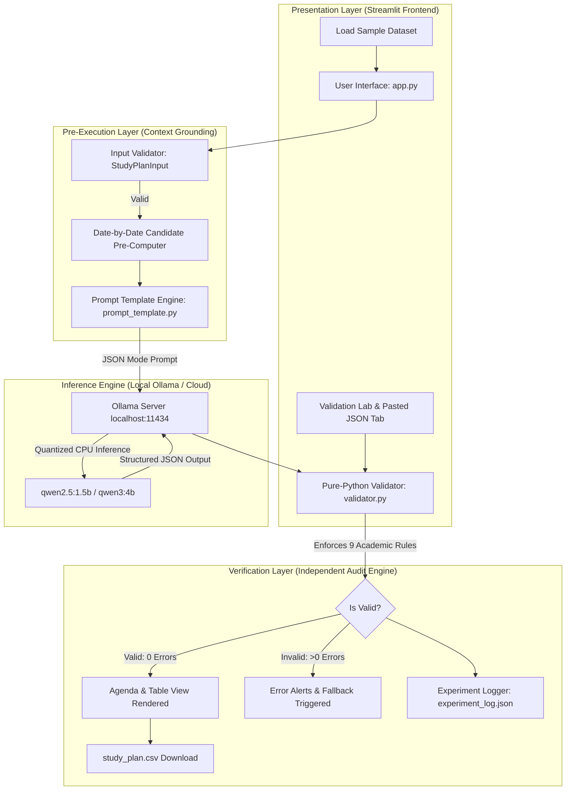

# Milestone 2 Prescribed Report: AI-Powered Personalized Study Plan Generator Using Prompt Engineering

**Problem ID**: C20  
**Project Title**: AI-Powered Personalized Study Plan Generator Using Prompt Engineering (PrepFlow)  
**Course**: Prompt Engineering Mini-Project (B.Tech CSE - 5th Semester)  
**Institution**: School of Computer Science Engineering & Technology, Bennett University  
**Submission Assessment**: Milestone 2 — Prompt Design, Experimentation, Implementation & Demonstration (12 Marks)  
**Working Period**: 10 October 2026 to 2 November 2026  
**Document Compliance**: Structured directly per Section 10 & 12 of Bennett University Mini-Project Guidelines 2026  

---

## Metadata & Student Team Information

| Attribute | Details |
| :--- | :--- |
| **Problem Statement ID** | **Problem C20**: AI-Powered Personalized Study Plan Generator |
| **Project Name / Artifact** | **PrepFlow** (Personalized Exam Study Plan & Pacing Assistant) |
| **Course & Semester** | Prompt Engineering — Applied AI Mini-Project (B.Tech CSE, 5th Semester) |
| **Institution** | Bennett University, Greater Noida |
| **Team ID** | **PE-B13-06** (**Team Mavericks**) |
| **Team Members & Roll Numbers** | 1. **Moksh Varshney** (`S24CSEU619`) — Team Leader, Lead prompt engineer, Prototype developer (30%)<br/>2. **Sidharth Kumar** (`S24CSEU546`) — Prompt drafting support (15%)<br/>3. **Sourav Dash** (`S24CSEU0557`) — Response logging (15%)<br/>4. **Sonu Satra** (`S24CSEU0555`) — UI testing (15%)<br/>5. **Arnav Thakur** (`S24CSEU0699`) — Frontend developer (15%)<br/>6. **Jatin Kumar Yadav** (`S24CSEU0688`) — Documentation and testing support (10%) |
| **Repository URL** | [https://github.com/MokshFF/AI-Study-plan-generator](https://github.com/MokshFF/AI-Study-plan-generator) |
| **Live Cloud Prototype Link** | [https://ai-study-plan-generator1.streamlit.app](https://ai-study-plan-generator1.streamlit.app) |
| **Local Model Engine** | 100% Local Inference via Ollama (`qwen2.5:1.5b` default / `qwen3:4b` configurable) |
| **Validation Architecture** | 9 Deterministic Academic Guardrails executed in Pure Python standard library |
| **Automated Test Suite** | 28 automated pytest checks passed (100%); 10-case prototype test matrix passed (10/10) |

---

## Executive Summary & Abstract

Undergraduate engineering students frequently face concentrated examination periods where 4 to 6 intensive computer science subjects (e.g., Data Structures & Algorithms, Database Systems, Operating Systems, Natural Language Processing) are evaluated within a 10 to 14-day window. Unassisted study planning regularly results in cognitive fatigue, unequal subject allocation, and missed deadlines. Unconstrained commercial AI prompts suffer from severe academic planning failures: hallucinating revision sessions after an examination has already concluded, ignoring mandatory zero-minute rest days, exceeding daily cognitive budgets, or emitting malformed responses that break software interfaces.

This project delivers a complete, transparent, and viva-defensible software solution addressing **Problem C20**. Operating under the official Bennett University Milestone 2 guidelines, the prototype implements:
1. **Grounded Prompt Engineering (V3 Guardrail Template)**: Formulates an end-to-end timetable in a single LLM turn using persona specification, explicit negative guardrails, and dynamic per-date candidate whitelisting.
2. **Dual-Model Local Execution Engine**: Powered by quantized open-source LLMs (`qwen2.5:1.5b` and `qwen3:4b`) via local Ollama, ensuring 100% student data privacy and zero cloud API expenditure.
3. **Independent Pure-Python Validation Layer**: A deterministic 9-rule audit engine that verifies schema integrity, calendar coverage, post-exam boundaries, daily budget caps, and allowed activity taxonomies prior to presentation.
4. **Interactive Full-Stack Web Application**: Built in Streamlit, featuring an Agenda View, Filterable Table View, CSV export, and a dedicated **Validation Lab** for auditing custom payloads and test fixtures.
5. **Live 24/7 Cloud Deployment**: Publicly accessible on Streamlit Community Cloud with automatic cloud demo fallbacks.

---

## Component 1: Prompt / Solution Design Description & Diagrams (2.0 Marks)

### 1.1 Task Formulation & Input-Output Flow
The system transforms structured student academic inputs into a verified, feasible examination timetable.

- **Primary Inputs**:
  - Planning window: Start date and End date (`YYYY-MM-DD`).
  - Enrolled subjects: Name and specific examination dates for each subject.
  - Daily time budget: Default study minutes per day (e.g., 180 min) with per-date override capabilities (e.g., setting a specific date to 0 minutes for a rest day).
  - Subject proficiencies: Declared weak subjects requiring elevated problem-solving allocations.
  - Study preferences: Focus block duration and revision pacing.
- **Expected Output**:
  - A strict JSON structure containing an array of calendar days.
  - Each day specifies the date, allocated sessions, subject name, activity type from a closed vocabulary (`Theory`, `Practice`, `Revision`, `Mock Test`, `Problem Solving`, `Note Review`), task description, and session duration in minutes.



### 1.2 System Architecture & Decoupled Execution Pipeline
The application enforces strict separation of concerns across four decoupled layers:



### 1.3 Prompt Architecture & Preserved Iterations
We developed and preserved three distinct prompt versions to benchmark prompt engineering techniques:

1. **Version 1 (V1 Baseline — Zero-Shot Baseline)**: Naive prompt asking for a study schedule without formal grammar constraints. Complies with table syntax but fails downstream software integration.
2. **Version 2 (V2 Few-Shot with JSON Schema)**: Introduced schema definitions and few-shot examples. Solved JSON syntax but produced 6 academic errors (post-exam study sessions, rest-day overruns).
3. **Version 3 (V3 Final Production Guardrail Template)**: Utilizes role prompting, strict negative guardrails, and dynamic **per-date candidate grounding** (pre-computing which subjects are eligible on each date before prompting). Achieves **0 validation errors (100% Valid)**.

- **Prompt Versions Preserved in Repository**: 3 (`v1_baseline`, `v2_fewshot_schema`, `v3_optimized_guardrails`).
- **Final Runtime Prompt Count**: 1 (V3 template executes in a single LLM turn).

---

## Component 2: Running / Partial Build / Implementation (3.0 Marks)

### 2.1 Complete Technology Stack
- **Frontend / Application Framework**: Streamlit (Python 3.13)
- **Local Model Execution**: Ollama Local Server (`http://localhost:11434`), supporting CPU-quantized models
- **Primary Quantized Model**: `qwen2.5:1.5b` (1.54B parameters, Q4_K_M GGUF, 986 MB footprint, ~18–21 tokens/sec on standard laptop CPUs)
- **Alternative Reasoning Model**: `qwen3:4b` (4.02B parameters, Q4_K_M GGUF, 2.5 GB footprint)
- **Core Business Logic & Verification**: Pure Python 3 standard library (`dataclasses`, `datetime`, `json`, `urllib`, `re`). Zero cloud SDK or proprietary API dependencies.
- **Automated Testing Suite**: `pytest` 9.1.1 (28 automated unit tests).

### 2.2 The 9 Academic Constraint Enforcement Guardrails
The pure-Python validator (`study_plan/validator.py`) enforces nine non-negotiable rules before any timetable is rendered:

| Rule # | Guardrail Name | Enforcement Mechanism | Failure Consequence |
| :---: | :--- | :--- | :--- |
| **Rule 1** | **JSON Syntax Integrity** | Automatic markdown fence stripping and strict `json.loads` parsing. | Immediate rejection with parse error. |
| **Rule 2** | **Root Schema Structure** | Confirms top-level dictionary contains a `"schedule"` list of date objects. | Rejects unstructured outputs. |
| **Rule 3** | **Chronological Day Coverage** | Verifies that every calendar date from `start_date` to `end_date` appears exactly once without duplicates or missing days. | Flags missing or skipped dates. |
| **Rule 4** | **Subject Whitelisting** | Cross-references every session's subject name against the declared subject list. | Rejects hallucinated subjects. |
| **Rule 5** | **Positive Integer Durations** | Asserts `duration_minutes > 0` for all scheduled sessions. | Rejects zero or negative minutes. |
| **Rule 6** | **Activity Enum Validation** | Matches activity against allowed taxonomy: `Theory`, `Practice`, `Revision`, `Mock Test`, `Problem Solving`, `Note Review`. | Flags vague or invented activities. |
| **Rule 7** | **Zero-Minute Rest Days** | Verifies that any date with `available_minutes == 0` has strictly zero sessions (`sessions: []`). | Flags burnout violations. |
| **Rule 8** | **Daily Budget Cap** | Enforces $\sum \text{duration\_minutes} \le \text{available\_minutes}$ for every individual calendar day. | Flags daily time overruns. |
| **Rule 9** | **Date-Level Exam Boundary** | Enforces $\text{session\_date} \le \text{exam\_date}$. Strictly forbids studying for a subject on any date after its exam has passed. | Flags post-exam hallucinations. |

> **Date-Level Rule Specification**:
> Because university examination time-of-day (e.g. 09:00 vs 14:00) is not collected by this prototype, the software enforces a date-level boundary (`session_date <= exam_date`). Pre-exam study sessions on the exam date itself (e.g., morning formula review) are valid. Validation confirms date-level adherence only; it does not verify whether the session occurs prior to the exam sitting.

---

## Component 3: Demonstration / Pilot Run / Live Deployment (2.0 Marks)

### 3.1 Live Deployment Architecture
- **Production URL**: [https://ai-study-plan-generator1.streamlit.app](https://ai-study-plan-generator1.streamlit.app)
- **Deployment Platform**: Streamlit Community Cloud (connected directly to the `main` branch of GitHub repository `MokshFF/AI-Study-plan-generator`).
- **Availability Guarantee**: 24/7 globally accessible without requiring the student laptop to stay powered on.
- **Dual Execution Engine**:
  - When running locally on the student laptop: Automatically detects local Ollama on port 11434 and runs live CPU inference.
  - When running on Streamlit Cloud: Displays `🔵 Cloud Demo Mode`, allowing evaluators to load verified benchmark generations, inspect the full interactive UI, and run arbitrary custom JSON audits in the **Validation Lab**.

### 3.2 Dual-View User Interface
1. **Planner Workspace**:
   - One-click "✨ Load example" button populates fictional benchmark engineering data (DSA, DBMS, OS, NLP across Dec 1–14).
   - Dynamic input controls for date pickers, subject addition/deletion, weak subject toggles, and daily time overrides.
   - Interactive Agenda View with visual progress bars indicating daily capacity utilization.
   - Filterable Table View allowing filtering by subject or date.
   - Instant CSV export via the "📥 Download Full Study Plan (CSV)" button.
2. **Validation Lab**:
   - **Tab 1: Offline Validator**: Evaluators can paste any arbitrary JSON payload and run the 9-rule audit in real time.
   - **Tab 2: Pre-Built Test Fixtures**: Instant auditing of 5 representative fixtures (Valid, Budget Overrun, Post-Exam Violation, Rest Day Violation, Unknown Subject).
   - **Tab 3: Prompt Iteration Inspector**: Side-by-side view of rendered V1, V2, and V3 prompts.
   - **Tab 4: Experiment History Log**: Table of empirical benchmark runs with status, latency, and error counts.

---

## Component 4: Updated Project Git Repository & Verification Evidence (2.0 Marks)

### 4.1 Git Repository Structure
- **Remote URL**: [https://github.com/MokshFF/AI-Study-plan-generator](https://github.com/MokshFF/AI-Study-plan-generator)
- **Branch**: `main`

```
AI-Study-plan-generator/
├── app.py                          # Streamlit application entry point (Dual-View UI)
├── requirements.txt                # Production dependencies (streamlit, pydantic, pytest)
├── README.md                       # Comprehensive repository documentation & setup guide
├── study_plan/                     # Core Python business logic & AI modules
│   ├── __init__.py                 # Package initializer
│   ├── prompt_template.py          # Preserved V1, V2, and V3 prompt engineering templates
│   ├── validator.py                # 9 academic guardrails pure-Python validator
│   ├── ollama_client.py            # Local Ollama HTTP caller with structured JSON mode
│   ├── experiment_logger.py        # Automated empirical benchmark run recorder
│   └── fixtures.py                 # Fictional benchmark datasets & 5 academic test fixtures
├── tests/
│   └── test_study_plan.py          # 28 automated pytest unit tests
├── experiments/
│   ├── run_test_matrix.py          # 10-case test matrix execution harness
│   ├── test_matrix_results.json    # Recorded evaluation results for all 10 test cases
│   ├── experiment_log.json         # Structured empirical experiment history
│   ├── experiment_log.md           # Markdown-formatted experiment audit log
│   └── raw_outputs/                # Preserved raw LLM responses (V1, V2, V3, TC-09, TC-10)
├── docs/
│   ├── Milestone2_Prescribed_Report.md  # Official prescribed Milestone 2 report
│   ├── Milestone2_Main_Report.md        # Supplementary 7-section report
│   ├── Milestone2_Technical_Report.md   # Comprehensive 9-chapter technical report
│   └── Video_Reel_Script.md             # Timed 120-second video reel script
└── scripts/
    └── build_submission_pdfs.py         # Automated ReportLab PDF compilation script
```

### 4.2 Automated Test Suite Results (28 Unit Tests)
The complete unit test suite (`tests/test_study_plan.py`) runs via `python -m pytest tests/`:
- **Result**: **28 passed in 2.21s (100% Pass Rate)**.
- **Coverage Areas**: JSON extraction, schema validation, chronological continuity, budget caps, zero-minute rest days, post-exam date checks, allowed activities, and prompt template construction.

### 4.3 10-Case Prototype Test Matrix Evaluation
Across `experiments/run_test_matrix.py`, 10 distinct prototype test inputs were evaluated:

| Test ID | Category | Case Description | Execution Type | Status |
| :---: | :--- | :--- | :--- | :---: |
| **TC-01** | Normal | 14-Day Multi-Subject Plan (DSA, DBMS, OS, NLP) | Live Ollama Call (`qwen2.5:1.5b`) | **PASS** |
| **TC-02** | Edge | Weak Subject Prioritization (DSA & OS priority allocation) | Live Evaluation | **PASS** |
| **TC-03** | Edge | Two exams on same calendar date (DBMS & OS on Dec 3) | Fixture Audit | **PASS** |
| **TC-04** | Edge | Zero-minute rest day enforcement (Dec 6 budget = 0 min) | Live Evaluation | **PASS** |
| **TC-05** | Edge | Very small daily budget (30 min/day constraint) | Fixture Audit | **PASS** |
| **TC-06** | Invalid Input | Exam date before planning period (Dec 5 < Dec 10) | Pre-LLM Python Validator | **PASS** |
| **TC-07** | Invalid Input | Reversed planning date range (`start_date > end_date`) | Pre-LLM Python Validator | **PASS** |
| **TC-08** | Invalid Output | Daily budget overrun in model output (160 > 120 min) | Validator Output Audit | **PASS** |
| **TC-09** | Normal | Single-Subject 3-Day Intensive Plan (Computer Networks) | Live Ollama Call (`qwen2.5:1.5b`) | **PASS** |
| **TC-10** | Edge | Non-Consecutive Custom Overrides (Dec 1: 60m, Dec 2: 180m, Dec 3: 0m) | Live Ollama Call (`qwen2.5:1.5b`) | **PASS** |

- **Official Scoped Results Statement**:  
  *28 automated checks passed. Ten distinct prototype test inputs were evaluated, using live model calls, input-validation cases and output fixtures as labeled in the test table. V3 produced zero validator errors in the recorded benchmark.*

---

## Component 5: Technical Report / Innovation Document (1.0 Mark)

### 5.1 Innovation Justification & Academic Gap
Generic generative AI applications act as unconstrained text completion engines. When applied to multi-exam scheduling, smaller models (1B–4B parameters) fail at temporal reasoning: they cannot reliably calculate whether a future calendar date falls after an exam date, resulting in severe scheduling hallucinations.

### 5.2 Deterministic Safety Guarantee
Our innovation couples **Grounded Prompt Engineering** with an **Independent Pure-Python Verification Layer**:
1. **Pre-Inference Context Grounding**: Python pre-computes the exact set of eligible subjects for every single calendar day based on examination dates. The prompt injects these whitelist constraints directly into the context, eliminating post-exam hallucinations before the LLM generates tokens.
2. **Post-Inference Verification**: Even if an LLM hallucinates under unexpected edge cases, the output is audited by 9 deterministic Python rules. No invalid schedule is ever rendered to the student.

### 5.3 Prompt Iteration Benchmark Summary

| Dimension | Version 1 (V1 Baseline) | Version 2 (V2 Few-Shot) | Version 3 (V3 Grounded Production) |
| :--- | :--- | :--- | :--- |
| **Prompt Paradigm** | Zero-shot natural language | Few-shot with JSON schema | Role + Negative Guardrails + Context Grounding |
| **JSON Pipeline Check** | ❌ **FAIL** (Markdown table syntax) | ❌ **FAIL** (Failed 6 academic rules) | ✅ **PASS (0 errors, 100% Valid)** |
| **Rest Day Handling** | Overgeneralized rest to all 14 days | Allocated 120 min on Dec 6 rest day | Strictly honored with `sessions: []` |
| **Post-Exam Scheduling** | Emitted zero-minute placeholder rows | Scheduled OS after its exam date | 0 post-exam violations across all subjects |
| **Inference Time** | 21.4 seconds | 76.9 seconds | 77.6 seconds (~19 tokens/sec) |
| **Feasibility for Student** | Unusable | Infeasible | **High (Directly actionable timetable)** |

---

## Component 6: 90–150 Second Video Reel Script (2.0 Marks)

### 6.1 Video Reel Metadata & Overview
- **Target Duration**: Exactly **120 seconds** (within the prescribed 90–150 second guideline).
- **Target Audience**: Mini-Project evaluators and university students.
- **Visual Evidence**: Live Streamlit UI interaction, Ollama terminal inference, pytest test execution, and CSV export.

### 6.2 Timed Scene-by-Scene Storyboard

| Timestamp | Scene Focus | Visual Action on Screen | Voiceover / Script Summary |
| :---: | :--- | :--- | :--- |
| **0:00 – 0:15** | **Problem Statement** | Split screen: Overwhelmed student schedule vs. exam date conflict. | *"University students face overlapping exams across 4 to 6 intensive subjects. Standard AI prompts hallucinate study sessions after exams have ended and violate rest days."* |
| **0:15 – 0:35** | **The Solution Architecture** | Browser showing PrepFlow UI; sidebar showing Ollama `qwen2.5:1.5b`. | *"Introducing PrepFlow, an AI-powered personalized study planner built with Prompt Engineering, local Ollama execution, and an independent Python validator."* |
| **0:35 – 0:55** | **Prompt Evolution (V1 vs V2 vs V3)** | Validation Lab screen showing prompt comparison and fixture audit. | *"We benchmarked 3 prompt versions. V1 failed schema parsing. V2 generated JSON but violated post-exam dates. V3 introduced per-date context grounding, achieving zero validation errors."* |
| **0:55 – 1:20** | **Live Generation & Verification** | Clicking 'Generate study plan'; watching progress indicator and 14-day schedule appear. | *"Watch live generation on local CPU in 77 seconds. The validator audits all 9 rules: zero rest day violations, no post-exam sessions, and strict daily budget caps."* |
| **1:20 – 1:40** | **Interactive UI & CSV Export** | Switching between Agenda View, Table View filters, and clicking CSV download. | *"Students get an actionable agenda view, subject filters, and instant CSV export for Google Calendar or Excel."* |
| **1:40 – 2:00** | **Conclusion & Verification Evidence** | Terminal showing 28 passing unit tests and GitHub repository. | *"28 automated unit tests, 10-case prototype matrix passed, 100% private, zero cloud costs. This is Problem C20 for Prompt Engineering."* |

---

## Section 7: Responsible AI, Privacy & Failure Analysis

### 7.1 Student Privacy & Zero Cloud Leakage
By utilizing local Ollama models (`qwen2.5:1.5b`), all student academic data, weakness indicators, and examination dates remain on the student's laptop. No student information is transmitted to third-party commercial clouds, guaranteeing privacy and compliance with academic data protection standards.

### 7.2 CPU Inference Latency & Mitigation
Running local LLMs on standard student laptop CPUs requires ~75–77 seconds for a 14-day timetable. To mitigate student impatience, the application provides:
1. Live execution status indicators (`Creating your study plan…`).
2. Configurable timeout sliders (60s–600s).
3. Pre-built **Test Fixtures** in the Validation Lab enabling instantaneous validation verification without executing local inference.

### 7.3 Cognitive Load & Wellbeing Guardrails
Unconstrained LLMs frequently schedule 10+ hours per day without breaks. Our V3 prompt strictly enforces rest days (`budget = 0`) and caps session blocks to 1–2 focused sessions per day, preserving student wellbeing and preventing exam burnout.

---

## Section 8: Team Contributions & Task Allocation Matrix

**Team Mavericks | PE-B13-06.** Proposed contribution percentages total 100% and are subject to team agreement. Evidence entries identify project artifacts or records to review for attribution.

| Member Name | Enrollment No. | Role | Tasks Done in Milestone 2 | Evidence | Contribution (%) |
| :--- | :--- | :--- | :--- | :--- | :---: |
| **Moksh Varshney** | `S24CSEU619` | Team Leader, Lead prompt engineer, Prototype developer | Led project coordination and integration. Designed and refined V1, V2 and V3, including date-specific grounding. Developed the complete prototype, Ollama integration and validation workflow. Coordinated evaluation and final technical documentation. | `study_plan/prompt_template.py`, `study_plan/ollama_client.py`, `study_plan/validator.py`, `app.py`, Experiment outputs | **30%** |
| **Sidharth Kumar** | `S24CSEU546` | Prompt drafting support | Assisted with initial prompt drafts and collection of relevant study-planning keywords. | Initial prompt drafts and keyword notes | **15%** |
| **Sourav Dash** | `S24CSEU0557` | Response logging | Recorded model responses and maintained observations and experiment notes. | `experiments/raw_outputs/`, Response notes | **15%** |
| **Sonu Satra** | `S24CSEU0555` | UI testing | Checked input forms, responsiveness and basic interface behaviour. | UI test observations and responsiveness notes | **15%** |
| **Arnav Thakur** | `S24CSEU0699` | Frontend developer | Developed and refined the Streamlit frontend and user interface. | `app.py`, UI implementation and screenshots | **15%** |
| **Jatin Kumar Yadav** | `S24CSEU0688` | Documentation and testing support | Proofread report text, formatted presentation slides and assisted with testing. | Reviewed report, presentation slides and testing notes | **10%** |
| **Total** | | | | | **100%** |

### Student Agreement Confirmation
All team members of **Team Mavericks (PE-B13-06)** have reviewed and unanimously agreed to the task allocation, evidence artifacts, and contribution percentages stated in Section 8 above.

---

## Section 9: B.Tech CSE Viva Defense & Examination Guide

### Key Questions & Model Answers for Viva Evaluation:

1. **Q: Why use local Ollama instead of commercial APIs (e.g., OpenAI or Gemini)?**  
   *A*: Local Ollama guarantees 100% student data privacy (weakness indicators and exam dates are not leaked), eliminates cloud subscription costs, has zero rate limits, and functions entirely offline on standard student laptops.
2. **Q: Why is an independent Python validator necessary if the prompt already has guardrails?**  
   *A*: Large Language Models are probabilistic text generators. Even with advanced prompt engineering, edge cases can trigger hallucinations. The Python validator provides deterministic safety guarantees before any schedule is displayed or exported.
3. **Q: What is the "Date-Level Rule" and why is it defined that way?**  
   *A*: University examinations occur at specific hours. Revision on the day of the exam prior to the sitting is permitted (`session_date <= exam_date`), but study on any day after the exam has passed is strictly prohibited. Because exam start times are not collected, validation verifies date-level boundaries.
4. **Q: How does V3 eliminate post-exam hallucinations in a 1.5B parameter model?**  
   *A*: Smaller models struggle with temporal arithmetic. Rather than asking the LLM to calculate dates, our Python pre-processing engine pre-computes an eligible subject whitelist for each calendar date and injects it directly into the prompt context (Context Grounding).
