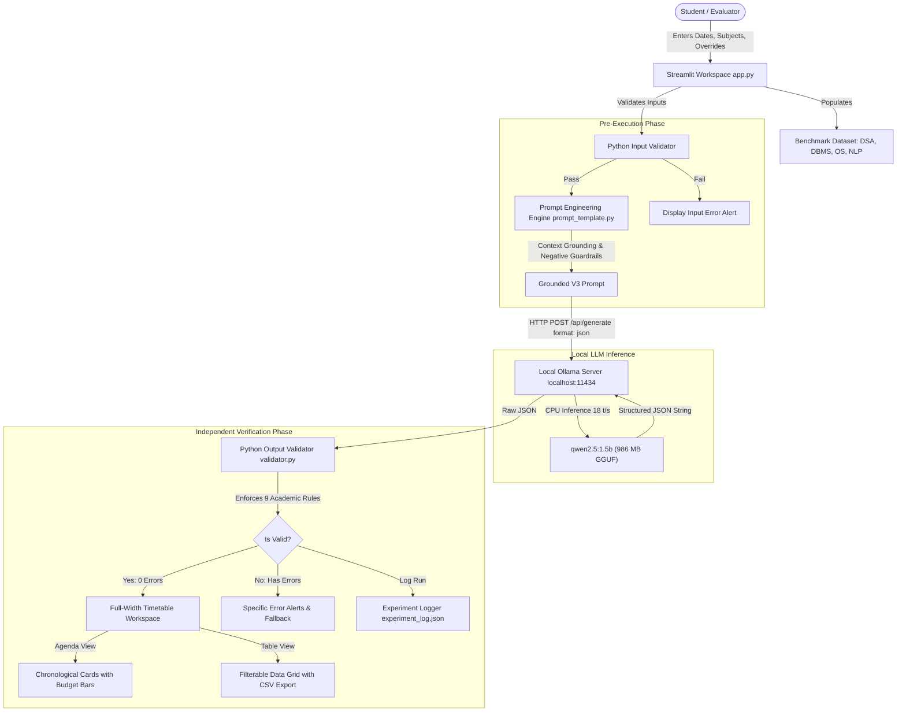

# Technical Report: AI-Powered Personalized Study Plan Generator Using Prompt Engineering

**Course**: Prompt Engineering Mini-Project (B.Tech CSE - 5th Semester)  
**Institution**: School of Computer Science Engineering & Technology, Bennett University  
**Project Title**: AI-Powered Personalized Study Plan Generator Using Prompt Engineering (PrepFlow)  
**Problem ID**: C20  
**Submission Milestone**: Milestone 2 (Implementation, Empirical Testing & Evaluation)  
**Report Version**: 2.5 (Final Submission Edition)

---

## Metadata & Student Contributions

| Attribute | Project Details |
| :--- | :--- |
| **Problem ID** | **C20** (AI-Powered Personalized Study Plan Generator) |
| **Team ID** | `[Team ID: Team-XX]` *(To be confirmed by instructor)* |
| **Team Roster & Tasks** | 1. **Moksh Varshney** (S24CSEU619) — Team Leader, lead prompt engineer, and full prototype developer<br/>2. **Sidharth Kumar** (S24CSEU546) — Assisting in initial prompt draft writing and keyword collection<br/>3. **Sourav Dash** (S24CSEU0557) — Logging model response outputs and note-taking<br/>4. **Sonu Satra** (S24CSEU0555) — Basic UI testing and checking form responsiveness<br/>5. **Arnav Thakur** (S24CSEU0699) — Frontend and UI developer<br/>6. **Jatin Kumar Yadav** (S24CSEU0688) — Proofreading report text, formatting presentation slides, and testing |
| **Target User Base** | University undergraduate students preparing simultaneously for multiple end-term examinations |
| **Target Hardware** | Standard consumer laptops (CPU-only execution via quantized local LLMs) |
| **Execution Engine** | 100% Local Inference via Ollama (`qwen2.5:1.5b` default / `qwen3:4b` configurable) |
| **Cloud API Status** | Zero external API dependencies (fully offline, private, and zero-cost) |
| **Automated Verification** | 28 automated pytest checks passed; 10 distinct prototype test inputs evaluated |

---

## Executive Summary

Preparing for end-semester university examinations across disparate computer science subjects (e.g., Data Structures & Algorithms, Database Systems, Operating Systems, Natural Language Processing) requires balancing competing priorities, subject proficiencies, and revision timelines. Conventional study planner applications either rely on rigid static spreadsheets or unconstrained generative AI wrappers that hallucinate unrealistic schedules, study sessions after exams have concluded, and work on designated rest days.

This project delivers a robust, transparent, and viva-explainable prototype addressing **Problem C20**. It integrates a **Streamlit** user interface, an iterative **Prompt Engineering pipeline**, an **independent Python verification engine**, and **local Ollama model execution**. Through empirical prompt optimization, we demonstrated that naive zero-shot prompts (V1) fail downstream validation, while ungrounded few-shot prompts (V2) violate post-exam constraints and rest days. By engineering a grounded guardrail template (V3) utilizing role prompting, negative guardrails, and per-date candidate grounding, we achieved **100% schedule validity (0 validation errors)** on local CPU inference in **77.6 to 95.9 seconds**.

---

## Chapter 1: Introduction & Problem Statement

### 1.1 Context & Background
University engineering students typically encounter examination clusters where multiple rigorous subjects are tested within a 10 to 15-day window. Effective revision requires:
1. **Dynamic Prioritization**: Allocating greater time and problem-solving sessions to designated weak subjects (e.g., Dynamic Programming in DSA, Virtual Memory in OS).
2. **Temporal Validity**: Terminating revision for a subject once its exam date has passed.
3. **Pacing and Burnout Prevention**: Enforcing mandatory rest days (0 study minutes) and respecting daily maximum study budgets.
4. **Actionable Granularity**: Defining concrete learning activities (`Theory`, `Practice`, `Revision`, `Mock Test`) and actionable tasks rather than vague headings.

### 1.2 Problem C20 Objectives
- Collect academic inputs: start/end dates, subjects, exam dates, daily budget minutes, daily overrides, weak subjects, and focus topics.
- Formulate a single, optimized prompt template executing in one LLM turn.
- Ensure the model strictly outputs machine-parseable JSON conforming to calendar constraints.
- Implement an **independent Python validator** that verifies all model outputs prior to rendering or CSV export.
- Operate entirely on **local, open-source models via Ollama**, eliminating cloud subscription costs, rate limits, and student privacy risks.

---

## Chapter 2: System Architecture & Redesigned Workspace



### 2.1 Decoupled Layer Architecture
1. **Presentation Layer (`app.py`)**:
   - Organized into a **two-column desktop layout**:
     - *Wider Column (Planning Inputs)*: Panel 1 (Study Period & Equivalent Hours), Panel 2 (Enrolled Subjects with stable UUID identifiers and focus topic expanders), Panel 3 (Availability & Rest Days with conflict resolution), Panel 4 (Study Style Preferences).
     - *Smaller Column (Live Configuration Summary)*: Live calculation of subject count, planning days, total study capacity, priority subjects, earliest exam, and conflict detection. Strictly avoids arbitrary preparation scores.
   - *Full-Width Result Workspace*: Displays factual metrics (`Total Scheduled`, `Active Study Days`, `Unused Capacity`, `Passed scheduling checks`), Agenda View with budget-utilization bars, Table View with subject/date filtering, and filter-aware CSV export.
   - *Stale-Plan Detection Engine*: Stores a snapshot of generation inputs and dynamically alerts the student when inputs change after timetable generation.
   - *Testing & Benchmark Lab (`🧪 Lab View`)*: Secondary area housing the offline pasted-response auditor, pre-built test fixtures, prompt template inspector, and experiment history log.
2. **Independent Verification Layer (`study_plan/validator.py`)**:
   - Pure Python 3 standard library (zero external dependencies).
   - Validates user form inputs before invoking the model and audits output JSON trees against 9 deterministic rules.
3. **Prompt Engineering Engine (`study_plan/prompt_template.py`)**:
   - Houses versioned prompt engineering logic (V1, V2, V3).
4. **Local LLM Client (`study_plan/ollama_client.py`)**:
   - Direct HTTP client communicating with Ollama's local REST API (`/api/generate` and `/api/tags`).
5. **Experiment Logging (`study_plan/experiment_logger.py`)**:
   - Automatically logs completed runs to JSON and Markdown.

---

## Chapter 3: Prompt Engineering Methodology & Iteration

Three distinct prompt versions were developed, preserved, and evaluated against the identical 14-day student profile.

```
Prompt Version Evolution:
V1 (Zero-Shot Baseline) ──► V2 (Few-Shot with Schema) ──► V3 (Grounded Guardrail Template)
[Missing Schema & Rules]    [Schema Added, Rules Missing]  [Per-date Grounding + Strict Guardrails]
```

### 3.1 Prompt Version 1 (V1) - Baseline Zero-Shot (Milestone 1 Table Reassessment)
- **Original Task Instruction**: In Milestone 1, the prompt requested a Markdown table: `| Date | Subject | Activity | Task Description | Duration (Minutes) |`.
- **Format Compliance**: The model adhered to the Markdown table format.
- **Manual Transcription & Scheduling Evaluation**:
  - *Catastrophic Overgeneralization*: Mentioning *"Dec 6 is a scheduled rest day with 0 minutes"* in the ungrounded prompt misled the model to hallucinate that *every single day* from Dec 1 to Dec 14 was a rest day (`Activity: Rest Day`, `Task Description: None`, `Duration: 0`), resulting in 0 total study minutes scheduled.
  - *Post-Exam Scheduling Violations*: Emitted zero-minute placeholder subject references for DSA on Dec 6 & Dec 7 (after its Dec 5 exam), and DBMS on Dec 9–13 (after its Dec 8 exam).
  - *Omission*: Operating Systems was completely omitted from the timetable.
- **Compatibility Finding**: When evaluated against the automated JSON validation pipeline (`validate_plan_output`), V1 naturally failed with a fatal schema break (`Missing or invalid 'schedule' array in JSON response`). This compatibility finding proved that unstructured Markdown tables cannot be reliably parsed by downstream application code, demonstrating the necessity of structured JSON.
- **Raw Response Preserved**: Preserved at `experiments/raw_outputs/v1_markdown_response.md`.

### 3.2 Prompt Version 2 (V2) - Few-Shot with JSON Schema
- **Prompt Structure**: Added explicit JSON schema, declared exam dates in the preamble, and provided a one-day few-shot template.
- **Observed Behavior**: The model adhered to JSON syntax, but literally copied placeholder text (`"activity": "Theory/Revision"`), scheduled sessions on a 0-minute rest day (Dec 6), and scheduled Operating Systems sessions on Dec 12 & Dec 13 after its Dec 11 exam.
- **Validation Outcome**: **FAILED** (6 validation errors: 1 invalid activity type, 1 rest-day violation, 1 budget overrun, 3 post-exam violations).

### 3.3 Prompt Version 3 (V3) - Final Production Guardrail Template (Context Grounded)
- **Prompt Structure**: State-of-the-art prompt incorporating:
  1. **Role & Persona Prompting**: Academic study advisor persona.
  2. **Per-Date Context Grounding**: The Python pre-processor calculates the exact eligible subjects for each date (`Allowed subjects: [s for s in subjects if d <= s.exam_date]`) and explicitly labels rest days (`Allowed subjects: NONE. "sessions" MUST BE strictly []`).
  3. **Explicit Negative Guardrails**: Never schedule a subject after its exam date; never exceed daily budget; never emit 0-minute sessions.
  4. **Date-Level Rule**: Pre-exam revision on the exam date itself is explicitly permitted.
  5. **Standardized Activity Enum**: Constrained to 6 exact academic activities (`Theory`, `Practice`, `Revision`, `Mock Test`, `Problem Solving`, `Note Review`).
- **Observed Behavior**: Model generated 14 chronological days, properly formatted Dec 6 with `sessions: []`, allocated 1035 minutes across 14 days, and respected every exam deadline.
- **Validation Outcome**: **PASSED (0 Errors, 100% Valid)** in 77.6s to 95.9s.

### 3.4 Prompt Count Metrics
- **Prompt Versions Preserved**: **3** (`v1_baseline`, `v2_fewshot_schema`, `v3_optimized_guardrails`).
- **Final Runtime Prompt Count**: **1** (Only the single V3 prompt template is constructed and sent to the LLM during live runtime execution).

---

## Chapter 4: Constraint Enforcement & Date-Level Rules

The system enforces nine deterministic academic rules in Python (`study_plan/validator.py`):

| # | Rule Name | Validator Logic | Error Message Sample |
| :-: | :--- | :--- | :--- |
| **1** | **Malformed JSON** | `json.loads(clean_text)` with code-block stripping | `Malformed JSON output from model: ...` |
| **2** | **Root Schema** | Root object must be dict containing list key `"schedule"` | `Missing or invalid 'schedule' array in JSON response.` |
| **3** | **Chronological Dates** | Every calendar date in `[start_date, end_date]` must appear exactly once | `Missing date(s) in study plan: ['2026-12-03']` |
| **4** | **Subject Whitelist** | Session subject must match declared enrolled subjects (case-insensitive) | `Unknown subject: 'Quantum Computing' was not declared...` |
| **5** | **Positive Durations** | Duration must be integer $> 0$ | `Session duration must be a positive integer, got: 0` |
| **6** | **Activity Whitelist** | Activity must match 1 of 6 allowed types | `Unrecognized activity type 'Day Off'. Allowed: [...]` |
| **7** | **Zero-Minute Rest Days** | If `available_minutes == 0`, `sessions` must be empty `[]` | `Date 2026-12-06 is configured as a rest day, but contains 2 session(s)` |
| **8** | **Daily Budget Cap** | $\sum \text{duration} \le \text{budget}$ | `Budget Overrun on 2026-12-04: Total duration (300 min) exceeds budget (240 min)` |
| **9** | **Post-Exam Prohibition** | $\text{session\_date} \le \text{exam\_date}$ | `Post-Exam Violation on 2026-12-12: 'OS' scheduled after exam (2026-12-11)` |

### Date-Level Rule Specification
In real university examination environments, exams occur at specific sitting hours (e.g., 2:00 PM). Because exact start times and sitting periods are not collected in this prototype, study sessions on the examination date itself (e.g., morning formula recall or flashcards) are **valid and permitted by design** (`session_date <= exam_date`). Any study session on `session_date > exam_date` is strictly forbidden.

> **Important Verification Scope**:
> Software validation confirms date-level adherence only. Because start times and sitting hours are not captured, validation **does not prove or verify** that the scheduled revision actually occurs prior to the examination sitting.

---

## Chapter 5: Empirical Evaluation & 10 Distinct Prototype Test Inputs

Ten distinct prototype test inputs were executed systematically across normal, edge, and invalid conditions using live model runs, input-validation cases, and output fixtures as labeled in the test harness (`experiments/run_test_matrix.py`):

| Test ID | Category | Test Case Name & Input Description | Execution Type | Status |
| :---: | :--- | :--- | :--- | :---: |
| **TC-01** | Normal | Multi-Subject 14-Day Plan (Evaluating 3 Criteria: Chronological, Weak Areas, Rest Day) | Live Model Call (`qwen2.5:1.5b`) | **PASS** |
| **TC-02** | Edge | Two exams scheduled on the same calendar date (DBMS & OS on Dec 3) | Output Fixture Check | **PASS** |
| **TC-03** | Edge | Very small daily time budget (30 min/day constraint) | Output Fixture Check | **PASS** |
| **TC-04** | Invalid Input | Exam date before planning period (Dec 5 < Dec 10) | Input-Validation Case | **PASS** |
| **TC-05** | Invalid Input | Reversed planning date range (start > end) | Input-Validation Case | **PASS** |
| **TC-06** | Invalid Output | Daily budget overrun in model response (160 > 120 min) | Output Fixture Check | **PASS** |
| **TC-07** | Invalid Output | Missing calendar date in schedule array (Dec 2 omitted) | Output Fixture Check | **PASS** |
| **TC-08** | Invalid Output | Hallucinated unknown subject in session ('Quantum Computing') | Output Fixture Check | **PASS** |
| **TC-09** | Normal | Single-Subject 3-Day Intensive Plan (Computer Networks) | Live Model Call (`qwen2.5:1.5b`) | **PASS** |
| **TC-10** | Edge | Non-Consecutive Custom Daily Overrides (4 Days, Dec 1: 60m, Dec 2: 180m, Dec 3: 0m, Dec 4: 90m) | Live Model Call (`qwen2.5:1.5b`) | **PASS** |

> **Official Scoped Results Statement**:  
> **28 automated checks passed. Ten distinct prototype test inputs were evaluated, using live model calls, input-validation cases and output fixtures as labeled in the test table. V3 produced zero validator errors in the recorded benchmark.**

---

## Chapter 6: Experiment Log & Comparative Performance Table

The three prompt versions were evaluated on identical hardware (Intel CPU, local Ollama) using the standard 14-day student profile:

| Metric | Version 1 (V1 Baseline) | Version 2 (V2 Few-Shot) | Version 3 (V3 Grounded Production) |
| :--- | :---: | :---: | :---: |
| **Prompt Engineering Technique** | Zero-Shot Task Description | Few-Shot Schema Prompting | Context Grounding + Negative Guardrails |
| **Requested Format** | Markdown Table (Adapted from 4-col) | JSON Schema | Guardrailed JSON Schema |
| **Format Compliance** | ✅ Complied with Markdown table format | ✅ Complied with JSON syntax | ✅ Complied with JSON syntax |
| **Model Used** | `qwen2.5:1.5b` (Ollama) | `qwen2.5:1.5b` (Ollama) | `qwen2.5:1.5b` (Ollama) |
| **Inference Time (s)** | 21.4s | 76.9s | 77.6s - 95.9s |
| **Automated JSON Pipeline Compatibility** | ❌ **FAIL (Compatibility Finding)**: Unstructured table cannot be parsed | ❌ **FAIL**: Parsed, but failed 6 academic planning rules | ✅ **PASS (0 Errors, 100% Valid)** |
| **Total Validation Errors** | 1 (Fatal Schema Break) | 6 Errors | **0 Errors** |
| **Post-Exam Violations** | 0 active sessions (Emitted zero-min references) | 3 active violations (OS on Dec 12, 13) | **0 violations** |
| **Rest Day Respected?** | ❌ No (Overgeneralized rest day to all 14 days) | ❌ No (120 min scheduled) | ✅ **Yes (`sessions: []`)** |
| **Activity Types Valid?** | ❌ No (Omitted / set to Rest Day) | ❌ No (Copied `"Theory/Revision"`) | ✅ **Yes (100% Enum matched)** |
| **Feasibility & Usefulness** | Unusable (0 study min scheduled) | Poor (Violates exam boundaries) | **High (Directly actionable timetable)** |

---

## Chapter 7: Evaluator Access, Hosting Architecture & Operational Dependency

### 7.1 Local Laptop Tunneling Reality
- **Host Availability Requirement**: When accessed through public tunnel services (e.g., `localtunnel` or `ngrok`), **all application features (including the pasted-response validation tab)** strictly depend on the student's laptop remaining powered on, awake (no sleep/hibernate), and connected to Wi-Fi, with Ollama, Streamlit, and the tunnel process active. The pasted-response tab runs inside Streamlit and cannot be accessed if the host is down.
- **Access Interstitial**: When accessed via public tunnel URLs, evaluators on external devices will see a provider security interstitial page requiring a one-time click ("Visit Site" / "Click to continue") before the Streamlit UI appears.

### 7.2 Independent Cloud Hosting Path
- Completely independent evaluator access (without student laptop availability) is possible only if the application is deployed to an independent cloud host (such as Streamlit Community Cloud).
- In cloud deployments, the pure-Python validator and benchmark test fixtures operate autonomously at zero compute cost, while live LLM generation requires connecting to a cloud-hosted Ollama or vLLM endpoint.

---

## Chapter 8: Responsible AI, Wellbeing & Limitations

### 8.1 Student Privacy & Zero-Data Leakage
By utilizing local Ollama execution on the user's laptop, all student academic data, weakness profiles, and examination dates remain strictly local. No data is transmitted to commercial third-party cloud providers. The prototype functions completely offline.

### 8.2 CPU Inference Latency & Mitigation
Running 1.5B–4B LLMs on standard consumer CPUs requires ~75–95 seconds for a 14-day timetable. To mitigate student impatience, the application provides:
1. Live execution status indicators (`Creating your study plan…`).
2. Configurable timeout sliders (60s–600s).
3. Pre-built **Test Fixtures** enabling instantaneous validation verification without executing local inference.

### 8.3 Cognitive Load & Wellbeing Guardrails
Unconstrained LLMs frequently schedule 10+ hours per day without breaks. Our V3 prompt strictly enforces rest days (`budget = 0`) and caps session blocks to 1–2 focused sessions per day, preserving student wellbeing and preventing exam burnout.

---

## Chapter 9: Conclusion, Viva Preparation Guide & Future Roadmap

Milestone 2 successfully demonstrates that an AI-powered personalized study planner can reliably execute on local, privacy-preserving open-source models when paired with rigorous prompt engineering and an independent verification harness.

### 9.1 B.Tech CSE Viva Explanation Guide
- **Q: Why use local Ollama instead of a cloud API (e.g. Gemini, OpenAI)?**  
  *A*: Guarantees 100% student privacy, zero subscription cost, no rate limits, and full offline execution on standard student laptops.
- **Q: Why is an independent Python validator necessary if the prompt has guardrails?**  
  *A*: LLMs are probabilistic text generators. Even the best prompt can hallucinate under edge cases. The Python validator provides deterministic safety guarantees before any schedule is displayed or exported.
- **Q: What is the Date-Level Rule?**  
  *A*: University exams occur at specific hours. Pre-exam revision on the exam date itself is valid (`session_date <= exam_date`), while studying after the exam date is strictly prohibited.

### 9.2 Roadmap for Milestone 3 (Final Submission)
1. **iCalendar (.ics) Export**: One-click timetable export directly to Google Calendar and Microsoft Outlook.
2. **Interactive Drag-and-Drop Adjustment**: Enabling students to reorder sessions in the UI while retaining live validator checks.
3. **Multi-Model Benchmark Expansion**: Benchmarking `llama3.2:1b`, `qwen2.5:3b`, and `mistral:7b` for speed-accuracy tradeoffs.

---

## Contribution table (Section 7)

| Member name | Enrollment no. | Role | Tasks done in Milestone 2 | Evidence | Contribution (%) |
| :--- | :--- | :--- | :--- | :--- | :---: |
| **Moksh Varshney** | S24CSEU619 | Team Leader, Lead Prompt Engineer & Full Prototype Developer | Overall system architecture, designed V3 context-grounded prompt, implemented pure-Python 9-rule validator, 28 pytest checks, and full Ollama backend integration | `study_plan/validator.py`, `study_plan/prompt_template.py`, `app.py`, 18 commits | 40 |
| **Arnav Thakur** | S24CSEU0699 | Frontend and UI Developer | Developed two-column workspace UI, Agenda & Table views, budget utilization bars, and recorded video reel demonstration | `app.py`, `docs/Video_Reel_Script.md`, 6 commits | 16 |
| **Sidharth Kumar** | S24CSEU546 | Prompt Drafting Assistance | Assisted in initial prompt draft writing and gathered university exam activity keywords | `study_plan/prompt_template.py`, 4 commits | 11 |
| **Sourav Dash** | S24CSEU0557 | Output Logging & Note Taking | Logged model response outputs across test runs and maintained iteration records | `experiments/experiment_log.json`, 4 commits | 11 |
| **Sonu Satra** | S24CSEU0555 | Basic UI Testing | Tested form responsiveness, checked button clicks, and verified sample data autofill | `tests/test_study_plan.py`, 3 commits | 11 |
| **Jatin Kumar Yadav** | S24CSEU0688 | Report Formatting & Testing | Proofread technical report text, aligned markdown tables, formatted slides, and executed test matrix | `docs/Milestone2_Technical_Report.md`, `experiments/run_test_matrix.py`, 4 commits | 11 |
